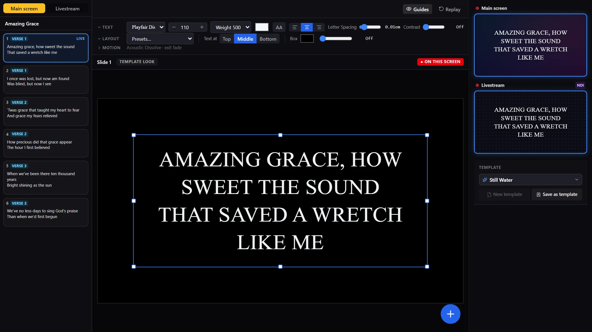
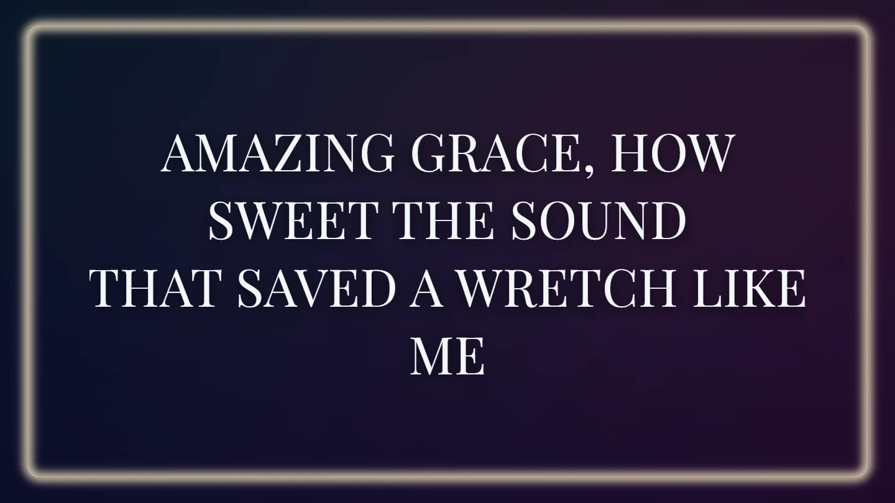
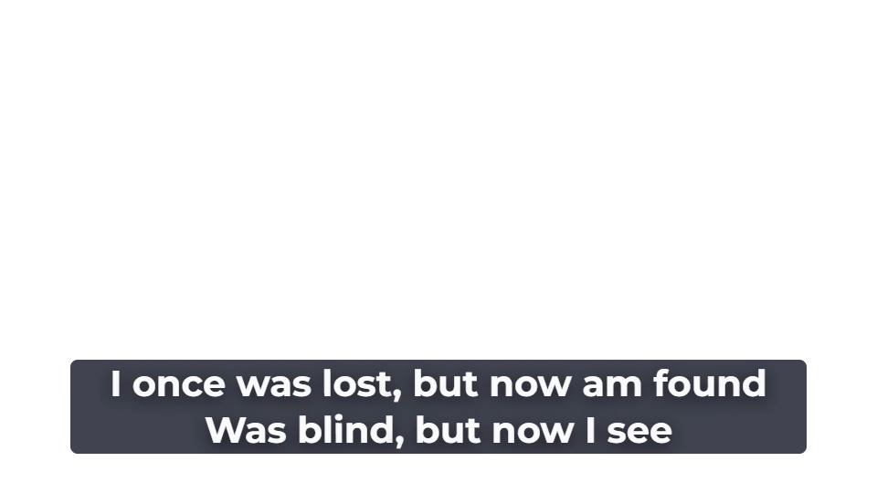
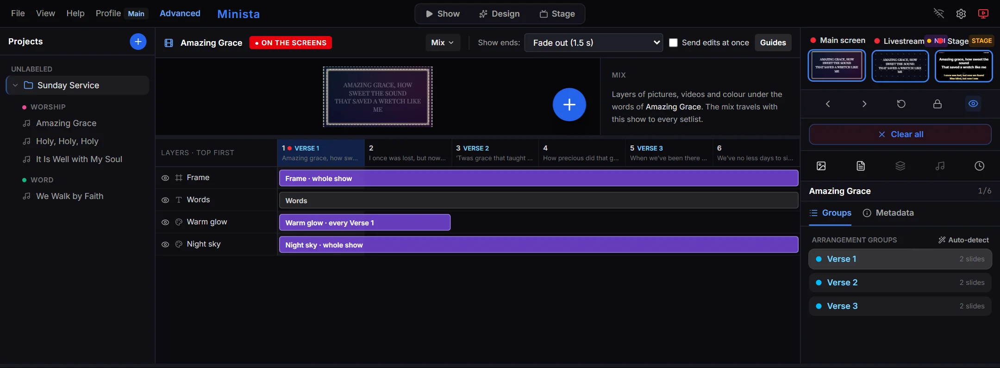

<h1 align="center">Minista</h1>

  Free worship presentation software for Windows. 
  Lyrics, scripture and media on every screen in your church, with full live control of how the words look.

  
  &nbsp;
  
  &nbsp;
  

 

## Download

**[Download the latest Minista](https://minista-website.vercel.app)** from the website, then run the installer. Minista is free, for 64-bit Windows 10 or 11.

Updating? Run the new installer over your current Minista. Your shows, Templates, Bibles, media and settings stay as they are.

Every version, with notes on what changed, is on the [Releases page](https://github.com/phenomenalphilip/minista-releases/releases).

## Preview

  

  
  &nbsp;
  

  

## What Minista is

Minista is made by The Fort Church Media for churches and media teams who want every screen to look right, every Sunday. Run the service from one place: the main screen, side screens, the livestream and the stage screens. You choose how the words look on each one and change it live, without stopping the service.

- **Show:** songs, declarations, scripture and presentations (PDF and PowerPoint), organised in projects and setlists for each service.
- **Design:** a large live canvas of each screen. Choose the font, size, colour, box fill, lower-third bars, motion and position. Your edits stay on the canvas until you send them to the screens.
- **Templates:** ready-made looks for songs and scripture, a Template Studio to make your own, and Template packs to share.
- **Mix:** layers of videos, pictures, colour and live inputs under or over the words, each playing over the slides you choose.
- **Screens:** any number of audience and stage screens, over HDMI or NDI. NDI sources, cameras and other screens can also come in as live inputs.
- **Stage screens:** layouts for the people on stage.
- **Phone remote:** move through the slides from your phone, over the church network, protected by a PIN.

## Report a problem or ask for a feature

Found a bug, or need something Minista doesn't do yet? [Open an issue](https://github.com/phenomenalphilip/minista-releases/issues). Tell us your Minista version (Help → About) and what you were doing when it happened.

## About this repository

This repository holds Minista's installers and release notes. The source code is kept private.

---

© The Fort Church Media. Minista is free to use.

